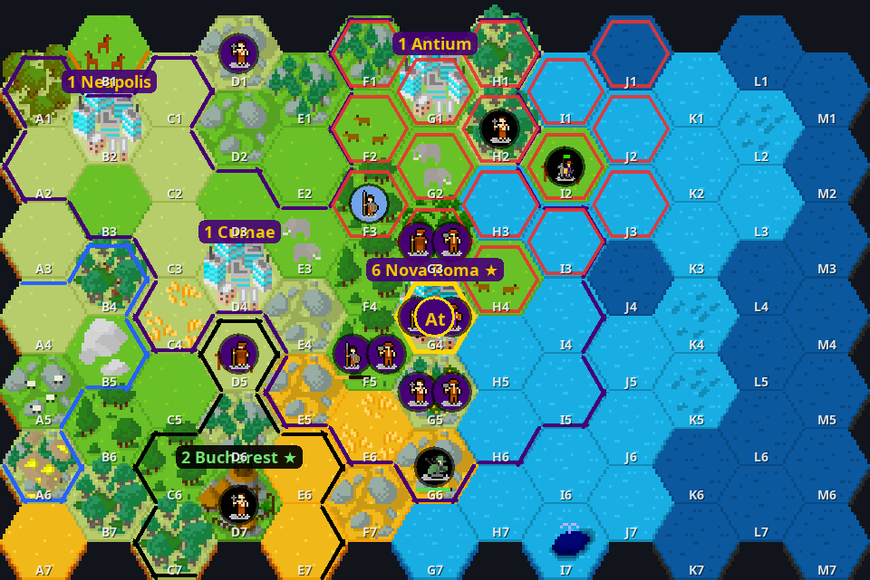
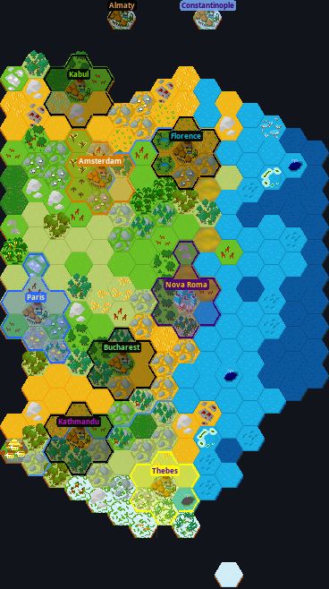
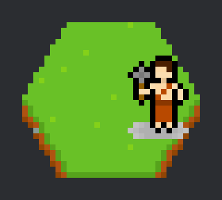
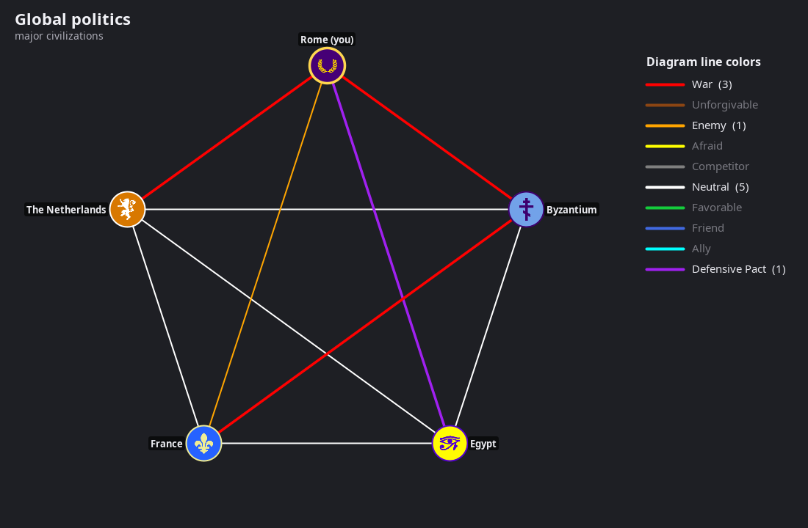

# CivBot: play Unciv inside Discord

**Complete 4X Civilization games, played entirely inside a Discord channel.**

CivBot runs the real [Unciv](https://github.com/yairm210/Unciv) engine (the open-source Civ V
remake) on your machine and turns it into Discord buttons, dropdowns and map images. You get
Unciv's rules, map generation, AI opponents, city-states, barbarians, religion, espionage,
diplomacy and every victory type. Players install nothing: they click.


- 🧑‍🤝‍🧑 **Multiplayer in a channel:** friends join a lobby and take turns, and the bot pings whoever is up. Solo games against AIs work too.
- 🌫️ **Real fog of war:** each player's panel is private (an ephemeral message), so only you see your empire.
- 🗺️ **Proper maps** drawn with Unciv's pixel-art tiles, with chess-style tile codes (`D5`) for every action.
- 🧩 **20+ panel tabs** covering what Unciv's screens do, from citizen management to nukes and World Congress votes.
- 🤖 **An AI advisor** fills in anything you skip, and AutoPlay can run your turns while you're away.
- 💾 **Saves after every action**, with undo within your turn and host rollback to earlier turns.
- 🧪 **An offline self-test** plays a full game and checks about 400 features on every change (CI included).

> CivBot is a fan project. It isn't affiliated with Unciv, Firaxis or Discord.

---

## Features

### ⚔️ Units and war
- Move with arrow buttons, or **🎯 Go to** a tile code or city name. Long trips continue on later turns, and the path is drawn on the map with "N turns to get there".
- Every Unciv unit action: found cities, build improvements (with yield previews, "replaces X" warnings and the reason something is blocked), connect roads, fortify or sleep (also until healed), explore, automate, pillage, paradrop, Great Person abilities, missionaries and prophets, upgrades, promotions (including along a path, plus saved defaults), escorts, swapping places, gifting units to city-states.
- **Combat preview** on every attack: expected damage both ways and a verdict ("likely win", "may die").
- Confirm steps for pillaging, disbanding and founding a city that breaks a promise.
- **🎖️ Military tab:** army overview, enemies in range, ☢️ nukes with a blast-radius preview and a confirm step, ✈️ air sweeps, strikes and rebasing.
- **👥 Group moves**, ⬆️ upgrade all units of a type, and a 🪖 overview of every unit.
- **🤖 AutoPlay:** military, civilians or economy once; a full turn; or your next N turns.

### 🏙️ Cities
- **🏗️ Production:**
  - full queue editing: move up, down, top or end; add to top; remove; do it in all cities at once
  - buy anything with any allowed currency (gold, faith…), even at its queue position
  - every production conversion
  - disable items you never want
- **👥 Citizens:** work or lock any tile (also by code), specialists, focus (including Manual), avoid growth, reassign while keeping locks.
- **📈 City details:** border growth, We Love the King Day and demanded luxuries, resistance, local resources, great-person points, religion pressure, a breakdown of any stat, the full buildings list, and why something can't be built (and which cities are missing a requirement).
- Buy tiles (any tile or a whole ring), sell buildings, rename, annex, raze or stop razing, bombard.
- **Captured cities:** keep, annex, puppet, raze or liberate. Liberating can bring a defeated civ back.
- **🏙️ Cities overview** (sortable) and **🏛️ Wonders**: who built what, and where you could.

### 🔬 Science, culture and faith
- Research the next tech (each option lists what it unlocks), set long-term goals, and queue several.
- Social policies with their effects and branch progress.
- Pantheons, founding and enhancing religions (a custom name, any number of beliefs), expanding pantheons, faith purchases.
- Free Great People, free techs, free policies.

### 🤝 Diplomacy
- **A deal builder** with every trade item Unciv has:
  - gold, gold per turn and any amount of a resource
  - cities, embassies, open borders, research agreements, defensive pacts
  - asking a third civ to declare war, peace
- **AIs answer on their own turn**, as in Unciv, and may counter-offer. You can counter their offers or withdraw yours.
- **War with a consequences check** (pacts, promises, allies) and Unciv's peace lock; friendship; denouncing.
- **🧭 Relations:** why each AI likes or dislikes you, promises, all active deals with turns left, and **📢 demands** you can make.
- **🏰 City-states:** influence, ally, bonuses, quests, tribute, gold and improvement gifts, protection, diplomatic marriage.
- **🕵️ Espionage** (steal tech, rig elections, coups, counter-intelligence) and **🗳️ World Congress** votes.
- Deals, peace and friendship between human players arrive in the game thread with Accept/Decline buttons.

### 📊 Information
- **📨 Inbox:** AI demands, friendship and trade offers, and random events with choices.
- **📰 News:** every notification; picking one jumps to the unit, city, tile or Civilopedia entry.
- **📊 Stats:**
  - a per-source breakdown of every stat, the score breakdown and unit supply
  - resources by origin, religions, global politics with a diagram
  - demographics, 📈 history charts, the full notification log
- **🏆 Victory** progress for every victory type, with every civ ranked by any stat.
- **🎞️ Replay** of the world map, turn by turn.
- **📖 Civilopedia** with search, cross-links and pixel art, plus `/civ wiki` for anyone.
- **🗺️ Map:** scroll anywhere, inspect any tile, or see your whole explored world.

### 🎛️ Hosting and setup
- A lobby with map size and type, difficulty and AI opponents, plus ⚙️ settings and **`/civ setup`** for **every other Unciv game option**: map shape, custom sizes, resources, sea level, seed, max turns, One City Challenge, raging barbarians, nukes, chosen AI nations and more.
- **Unciv mods from GitHub** (search with `/civ mod action:browse`), **custom maps** from Unciv's map editor, and **scenarios**.
- **Save export and import** to move games between Discord and desktop Unciv.
- One thread per game, turn pings, reminders, AFK auto-skip, spectating, kick and host handover, and rollback (every player votes).

### What it can't do
- **No map editor inside Discord.** Make maps in Unciv's own editor and upload them.
- **No manual fighter interception.** Unciv has none either; fighters intercept automatically.
- **No turns played at the same time.** Turns are hotseat-style, one player at a time, because that's how Unciv's engine works.

## Gallery

| | |
|---|---|
|  |  |
| ☢️ Nuke preview: the blast zone in red, with a confirm step before launch | 🎞️ Replay: the world as it was on an earlier turn |
|  |  |
| 📖 Civilopedia entries use Unciv's own pixel art | 📊 Who's at war, allied or friendly, at a glance |

## Quick start

You need **Java 21**, **git**, and a computer that's on while people play. Your own PC works fine.

```bash
git clone https://github.com/milk4sale/unciv-discord-bot.git
cd unciv-discord-bot
./setup.sh                    # downloads Unciv, builds the bot (first run: a few minutes)
cp .env.example .env          # paste your bot token into .env
./run.sh                      # or ./scripts/install-service.sh to run it in the background
```

Then type **`/civ new`** in any channel of your server.

Creating the Discord bot and inviting it takes about five minutes. **[docs/SETUP.md](docs/SETUP.md)**
walks you through every click.

## Documentation

| Guide | For |
|---|---|
| [**Setup**](docs/SETUP.md) | creating the Discord app, inviting the bot, installing, running in the background, updating |
| [**How to play**](docs/PLAYING.md) | players: starting a game, the panel, every tab and action, diplomacy, tips |
| [**Hosting games**](docs/HOSTING.md) | game settings, `/civ setup`, mods, maps, scenarios, saves, rollback, host commands |
| [**Troubleshooting**](docs/TROUBLESHOOTING.md) | "did not respond", "command is outdated", missing permissions, build problems |
| [**Activity add-on**](docs/ACTIVITY.md) | an optional embedded web app version of the panel |
| [**Development**](docs/DEVELOPMENT.md) | how it works, the extension modules, the self-test, updating Unciv |

## Commands at a glance

| Command | What it does |
|---|---|
| `/civ new` | open a game lobby in this channel |
| `/civ play` | open your private panel |
| `/civ board` · `/civ games` · `/civ spectate` | re-post the board · list your games · watch a game you're not in |
| `/civ leave` | hand your civilization to the AI |
| `/civ autoplay turns:N` | let the AI play your next N turns (any click stops it) |
| `/civ kick @player` · `/civ host @player` · `/civ end` | host tools |
| `/civ lobby …` · `/civ setup …` · `/civ espionage` | host: mods, base rules, map, scenario · every other game option · spies on/off |
| `/civ save export` · `/civ save import` | download a game for desktop Unciv (after it ends, or if the host allows it) · start a lobby from an Unciv save |
| `/civ rollback` | host: go back to an earlier turn (all players must agree) |
| `/civ mod …` · `/civ map …` | browse, install or remove Unciv mods (from GitHub) and custom maps (Manage Server) |
| `/civ wiki query:…` | Civilopedia lookup for anyone |
| `/civ help` | an in-Discord quick guide |

## Credits and license

- Game engine, rules and art: **[Unciv](https://github.com/yairm210/Unciv)** by yairm210 and
  contributors (Mozilla Public License 2.0). CivBot downloads Unciv at build time and doesn't
  redistribute it.
- Map tiles: the *Fantasy Hex* tileset by [CuddlyClover](https://cuddlyclover.itch.io/fantasy-hex-tiles)
  with additions by Unciv contributors (CC BY 4.0). Other sprites: see
  [Unciv's credits](https://github.com/yairm210/Unciv/blob/master/docs/Credits.md).
- Discord library: [JDA](https://github.com/discord-jda/JDA) (Apache 2.0).
- CivBot's own code and docs are released under the **WTFPL** (see [LICENSE](LICENSE)): do
  whatever you want with them. This doesn't cover Unciv, JDA or the game art shown in
  `docs/images/` and drawn by the bot, which keep their own licenses above.
