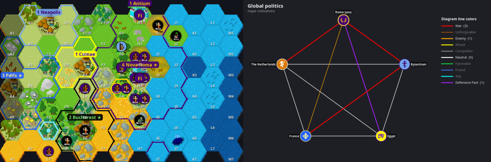

# CivBot: play Unciv inside Discord

**Full 4X Civilization games, played entirely inside a Discord channel.**
CivBot runs the real [Unciv](https://github.com/yairm210/Unciv) engine (the open-source Civ V
remake) and turns it into buttons, dropdowns and map images. You get Unciv's rules, maps, AI
opponents, city-states, barbarians, religion, diplomacy and victories. Everyone plays from
Discord, with nothing to install as a player.



- 🧑‍🤝‍🧑 **Multiplayer in a channel:** friends join a lobby and take turns. The bot pings whoever is up.
- 🌫️ **Real fog of war:** each player's panel is private (ephemeral), so only you see your empire.
- 🗺️ **Proper map images** drawn with Unciv's pixel-art tileset, with chess-style tile codes (`D5`).
- 🤖 **AI opponents and an AI advisor** that can fill in any decision you'd rather skip.
- 💾 **Saves after every action**, so restarting the bot never loses a game.
- 🧪 **Offline self-test** that plays a whole game and checks every feature without Discord.

> CivBot is a fan project. It isn't affiliated with Unciv, Firaxis or Discord.

---

## What you can do

| Panel tab | Features |
|---|---|
| ⚔️ **Units** | move with arrow buttons or 🎯 *Go to* a tile code / city; found cities; build roads, farms, mines… and queue the next improvement; 🛣️ connect a road to any tile or city; fortify, sleep (also until healed), explore, automate; attack; promotions and upgrades; escort pairs; pillage; paradrop; gift units to city-states; rename; Great Person abilities; missionaries and prophets; **↩️ undo** |
| 🏙️ **Cities** | production with an optional 📋 queue; buy with gold or faith; city bombard; citizen focus; buy tiles; sell buildings; rename; annex puppets; raze / stop razing; **↩️ undo** |
| 👥 **Citizens** | choose exactly which tiles each city works, lock tiles, assign specialists, avoid growth |
| 🎖️ **Military** | army overview, wars and enemies in range, ☢️ nukes with a blast preview and a confirm step, ✈️ air sweeps, air strikes, rebasing to cities or carriers |
| 🔬 **Research** | pick the next tech (each option lists what it unlocks) or set a far-off goal and the whole path is queued |
| 📜 **Policies** | adopt social policies when your culture allows |
| 🙏 **Religion** | found a pantheon, name your religion, choose founder / follower / enhancer beliefs |
| 🤝 **Diplomacy** | a deal builder (gold, gold per turn, luxuries, strategic resources, techs, **cities**, embassies, open borders, research agreements, defensive pacts, **asking a third civ to join a war**, peace), war, friendship, denouncing |
| 🏰 **City-states** | gold gifts, pledge protection, demand tribute, see influence, allies and quests |
| 🕵️ **Espionage** | move spies to steal technology, rig city-state elections, stage coups, or guard your own cities |
| 🗳️ **World Congress** | vote for world leader, see the tally and what's needed to win |
| 📨 **Inbox** | answer AI demands, friendship offers and AI trade offers yourself; news |
| ✨ **Beliefs** | expand your pantheon, add free beliefs to your religion |
| 📊 **Overview** | empire stats, happiness breakdown, golden ages, resources, rankings, Great People, recent history |
| 🏆 **Victory** | progress towards every victory type (spaceship parts, policy trees, capitals, votes, time), score ranking |
| 📖 **Civilopedia** | every unit, building, wonder, tech, policy, belief, resource, terrain and nation, with search and pixel art |
| 🗺️ **Map** | scroll anywhere, 🔍 inspect any tile, 🌍 view the whole explored world |

Plus:
- a lobby with full game settings, including **Unciv mods from GitHub**, **custom maps** made in
  Unciv's map editor, **scenarios** and **espionage**
- one thread per game, with turn pings and reminders, and optional AFK auto-skip
- deals, peace and friendship offers between human players, answered with Accept/Decline buttons
- captured-city decisions, spectating and host tools
- `/civ wiki` lookups for anyone, even outside a game

An optional **Discord Activity** add-on shows the same panel as an embedded web app.

## Quick start

You need **Java 21**, **git**, and a computer that stays on while people play. Your own PC works
fine.

```bash
git clone https://github.com/milk4sale/unciv-discord-bot.git
cd unciv-discord-bot
./setup.sh                    # downloads Unciv, builds the bot (first run: a few minutes)
cp .env.example .env          # paste your bot token into .env
./run.sh                      # or ./scripts/install-service.sh to run it in the background
```

Then type **`/civ new`** in any channel of your server.

Creating the Discord bot and inviting it takes about five minutes. **[docs/SETUP.md](docs/SETUP.md)**
walks you through it with every click.

## Documentation

| Guide | For |
|---|---|
| [**Setup**](docs/SETUP.md) | creating the Discord app, inviting the bot, installing, running in the background, updating |
| [**How to play**](docs/PLAYING.md) | players: starting a game, the panel, every tab and action, diplomacy, tips |
| [**Hosting games**](docs/HOSTING.md) | game settings, host commands, AFK players, threads, spectators |
| [**Troubleshooting**](docs/TROUBLESHOOTING.md) | "did not respond", "command is outdated", missing permissions, build problems |
| [**Activity add-on**](docs/ACTIVITY.md) | optional embedded web app version of the panel |
| [**Development**](docs/DEVELOPMENT.md) | how it works, code layout, self-test, updating Unciv |

## Commands at a glance

| Command | What it does |
|---|---|
| `/civ new` | open a game lobby in this channel |
| `/civ play` | open your private panel |
| `/civ board` | re-post the game board |
| `/civ games` | list your games |
| `/civ spectate` | watch a game you're not in |
| `/civ leave` | hand your civilization to the AI |
| `/civ kick @player` · `/civ host @player` · `/civ end` | host tools |
| `/civ lobby …` · `/civ espionage` | host: pick mods, base rules, custom map, scenario; turn spies on |
| `/civ mod …` · `/civ map …` | list, install or remove Unciv mods (from GitHub) and custom maps (Manage Server) |
| `/civ wiki query:…` | Civilopedia lookup for anyone |
| `/civ help` | in-Discord quick guide |

## Credits and license

- Game engine, rules and art: **[Unciv](https://github.com/yairm210/Unciv)** by yairm210 and
  contributors (Mozilla Public License 2.0). The map tiles are Unciv's *FantasyHex* tileset; see
  Unciv's credits for the artists. CivBot downloads Unciv at build time and doesn't redistribute it.
- Discord library: [JDA](https://github.com/discord-jda/JDA).
- CivBot itself is released under the **Mozilla Public License 2.0** (see [LICENSE](LICENSE)),
  the same license as Unciv.
